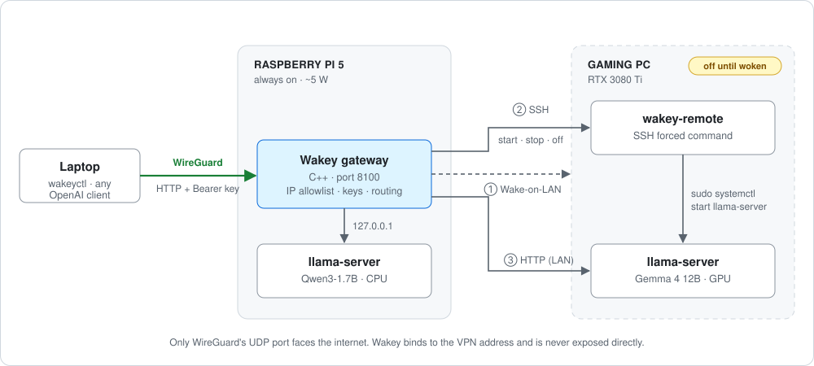

# Wakey

**A small C++ gateway that runs local LLMs on a Raspberry Pi and wakes a GPU PC only when you ask for it.**

Wakey lives on a Raspberry Pi 5 and serves one OpenAI-compatible API for two machines:
a small model that runs on the Pi itself (always available, nearly silent), and a bigger
model on a gaming PC with an RTX 3080 Ti that stays **powered off** until you need it.
One command wakes the PC over Wake-on-LAN, starts the model server over SSH and reports
when it's ready. Another powers it off again.

Everything stays local: no cloud APIs, no tokens leaving the house, and the gateway is
reachable only through WireGuard.

```
── gemma-4-12b · pc up · thinking off · ctx 1.5k/33k ░░░░░░░░░░ 4%
❯ explain wake-on-lan in one sentence
Wake-on-LAN lets a powered-off computer be switched on remotely by sending a
special "magic packet" containing its MAC address to its network card.
29 tokens · 84 t/s · 0.4 s
```

## Why

A GPU box is great for running a 12B model, but leaving it on 24/7 to answer a few
questions a day wastes power and wears out hardware. A Raspberry Pi is the opposite:
always on, ~5 W, but only fast enough for small models. Wakey combines the two:

- **Small questions** go to Qwen3-1.7B on the Pi, instantly.
- **Bigger work** goes to Gemma 4 12B on the PC, which boots on demand (~35 s cold start)
  and shuts down when *you* say so.
- **You stay in control.** The PC is never woken or powered off on its own, and booting it
  by hand (to use it for something else) never starts the model server.

## Architecture



1. A client sends a normal OpenAI-style request to `/v1/chat/completions`.
2. Wakey checks the client's IP and API key, looks up which backend serves the requested
   model, and forwards the request.
3. If the backend is the PC and it's off, Wakey answers `503` with a hint to wake it.
   Waking happens only on an explicit `POST /admin/pc/wake`.
4. On wake, Wakey sends a magic packet, keeps retrying `start` over a restricted SSH key
   until the PC has booted and `llama-server` is launched, then polls until the model is
   loaded. One shared deadline covers the whole sequence.

## Features

- **OpenAI-compatible proxy.** Works with anything that speaks `/v1/chat/completions`.
  Requests are routed by model name.
- **Power control on demand.** Wake (Wake-on-LAN + SSH), stop the model server, or power
  off, each with its own admin endpoint.
- **Safe concurrency.** Per-backend atomic state: a second wake while one is running gets
  `409`, a poweroff is refused while requests are still running, and chat is blocked
  (`503`) during a power operation.
- **`wakeyctl`, a CLI and chat TUI.** One-shot commands plus an inline chat with history,
  Tab completion, a spinner (Ctrl+C cancels) and a status bar that shows how full the
  model's context is.
- **Status at a glance.** `/admin/status` reports each backend's state, running requests
  and context size.

## Security model

Wakey was designed to **never be on the public internet**. Several layers enforce this:

| Layer | What it does |
|---|---|
| Bind address | Wakey refuses to start on `0.0.0.0`. It must bind to one address (the WireGuard IP) inside `allowed_clients`. |
| IP allowlist | Every request is checked against a CIDR range (`allowed_clients`). Only private ranges are accepted in the config. |
| Two keys | `/v1/*` needs the API key, `/admin/*` needs a separate admin key. Keys are compared in constant time. |
| Key files | Keys are read from files that must be private (`chmod 600`), or Wakey refuses to start. |
| Firewall | `ufw` on the Pi only allows port 8100 on the WireGuard interface. |
| Restricted SSH | The Pi's SSH key on the PC is locked down with `restrict`, `from=` and a forced command, so it can only run `start`, `stop` or `poweroff`. |
| Exact sudo rules | The PC's sudoers file allows exactly three `systemctl` commands, nothing else. |
| No auto-start | `llama-server` on the PC has no `[Install]` section, so a normal boot never starts it. |

## Benchmarks

**Model speed** (`llama-bench`, prompt 512 / generate 128 tokens):

| Machine | Model | Prompt | Generation |
|---|---|---|---|
| Raspberry Pi 5, CPU, 4 threads | Qwen3-1.7B Q4_K_M | ~48 t/s | ~7.4 t/s |
| PC, RTX 3080 Ti | Gemma 4 12B Q4_K_XL | ~3311 t/s | ~84.7 t/s |

**Gateway overhead**: the same tiny request sent directly to `llama-server` and through
Wakey (50 runs, measured from the Pi with [`bench/overhead.sh`](bench/overhead.sh)):

| Backend | Direct (median) | Through Wakey (median) | Overhead |
|---|---|---|---|
| Pi · Qwen3-1.7B | 108.8 ms | 110.3 ms | +1.5 ms |
| PC · Gemma 4 12B | 32.1 ms | 33.0 ms | +0.9 ms |

Wakey adds about a millisecond per request, which is well under 0.1 % of a typical answer.

**Cold start** (PC powered off → model ready): **~35 s**, of which ~29 s is booting and
~6 s is loading the model onto the GPU.

Full results and conditions: [`bench/results.md`](bench/results.md).

## Using it

```bash
wakeyctl status                      # all backends: up/down, running requests, context size
wakeyctl wake pc                     # boot the PC and start its model (~35 s)
wakeyctl ask "what is a KV cache?"   # one question, default model
wakeyctl ask --think "..." gemma-4-12b
wakeyctl chat [--think] [model]      # interactive chat
wakeyctl stop pc                     # stop the model server, PC stays on
wakeyctl poweroff pc                 # shut the PC down (asks first; -y to skip)
```

Inside `chat`:

| Command | |
|---|---|
| `/model [name]` | show or switch the model (the conversation comes along) |
| `/think` | toggle the model's thinking mode |
| `/clear` | start a new conversation |
| `/status` | show all backends |
| `/wake`, `/stop`, `/poweroff <backend>` | power control without leaving the chat |
| `/help`, `/exit` | |

Only `/commands` are saved to the history file (`~/.local/state/wakey/history`, mode 600).
Your prompts stay in memory and are never written to disk.

### API

| Method | Path | Key | Description |
|---|---|---|---|
| `GET` | `/health` | – | liveness check |
| `POST` | `/v1/chat/completions` | API | OpenAI-compatible chat, routed by `model` |
| `GET` | `/admin/status` | admin | backend states, `in_flight`, `n_ctx` |
| `POST` | `/admin/<backend>/wake` | admin | wake + start model; returns boot/load/total seconds |
| `POST` | `/admin/<backend>/stop` | admin | stop the model server |
| `POST` | `/admin/<backend>/poweroff` | admin | power off (refused while requests run) |

## Setup

### Prerequisite: WireGuard

Wakey has to sit behind a WireGuard VPN. It binds only to the VPN address and accepts
only clients from the VPN subnet, so without a tunnel there is nothing to connect to.
That's by design.

Run the WireGuard server on the machine that hosts Wakey (here the Pi), and add every
client device as a peer. Two common ways:

- **[PiVPN](https://pivpn.io)**: an installer script for Raspberry Pi OS / Debian that
  sets up WireGuard. It's maintained on a best-effort basis, so keep that in mind.
- **Plain WireGuard**: `wg-quick` with a hand-written `/etc/wireguard/wg0.conf`, on any
  Linux host.

Your router only needs to forward the WireGuard UDP port (51820 by default) to the host.
**Never forward Wakey's port (8100).** Then use the host's VPN address (e.g. `10.x.x.1`)
as `bind_address`, and the VPN subnet as `allowed_clients`.

On each client, the peer's `AllowedIPs` must include the host's VPN address
(e.g. `10.x.x.1/32`). Otherwise traffic to Wakey never enters the tunnel, and `ping`
fails with "Required key not available".

### Build

Requires CMake ≥ 3.20 and a C++20 compiler. Dependencies are vendored in `third_party/`.

```bash
git clone https://github.com/p-zzz/Wakey && cd Wakey
cmake -B build && cmake --build build
ctest --test-dir build
```

This builds `wakey` (the gateway) and `wakeyctl` (the client).

### Pi (gateway)

1. Build and install [llama.cpp](https://github.com/ggml-org/llama.cpp) and download a small GGUF model.
2. Create two keys, readable only by you:
   ```bash
   mkdir -p keys && chmod 700 keys
   openssl rand -hex 32 > keys/api.key
   openssl rand -hex 32 > keys/admin.key
   chmod 600 keys/*.key
   ```
3. Copy `config.example.json` to `config.json` and fill in your WireGuard address,
   backends, MAC address and SSH key.
4. Install the user units from `deploy/pi/` into `~/.config/systemd/user/`, then:
   ```bash
   systemctl --user daemon-reload
   systemctl --user start wakey     # also starts the Pi's llama-server
   ```
   The units are deliberately not enabled: Wakey runs when you start it.

### PC (GPU backend)

1. Enable Wake-on-LAN in the BIOS and on the network card.
2. Install `deploy/pc/llama-server.service` (no `[Install]` section, so it never starts at boot).
3. Install `deploy/pc/wakey-remote` as the forced command for the Pi's SSH key, e.g. in
   `~/.ssh/authorized_keys`:
   ```
   restrict,from="<pi-ip>",command="/usr/local/bin/wakey-remote" ssh-ed25519 AAAA... wakey
   ```
4. Install the sudoers rule from `deploy/pc/wakey` (see the comment inside), and check it
   with `sudo visudo -c`.

### Laptop (client)

```bash
mkdir -p ~/.config/wakey && chmod 700 ~/.config/wakey
cp client.example.json ~/.config/wakey/client.json   # set the url
# copy api.key and admin.key from the Pi into ~/.config/wakey/ (chmod 600)
ln -s "$PWD/build/wakeyctl" ~/.local/bin/wakeyctl
```

## Project layout

```
src/
  gateway.cpp        HTTP server: routing, auth, proxy, power endpoints
  config.cpp         config loading and validation (bind address, CIDR, keys)
  net_guard.cpp      IPv4 / CIDR parsing and private-range checks
  auth.cpp           constant-time key comparison
  wol.cpp            Wake-on-LAN magic packet
  power.cpp          run_remote: ssh via posix_spawnp, exit-code mapping
  health.cpp         backend health checks and context size (/props)
  wake_and_wait.cpp  early standalone tool: send WoL and wait for a backend
  keyfile.cpp        private key-file checks, ~ expansion
tools/
  wakeyctl.cpp       CLI client and chat TUI
  remote_test.cpp    manual test for run_remote
deploy/              systemd units, SSH dispatcher and sudoers rule
bench/               benchmark script and results
tests/               unit tests (CIDR parsing and matching)
```

## Built with

[cpp-httplib](https://github.com/yhirose/cpp-httplib) ·
[nlohmann/json](https://github.com/nlohmann/json) ·
[replxx](https://github.com/AmokHuginnsson/replxx) ·
[llama.cpp](https://github.com/ggml-org/llama.cpp)

## Roadmap

- Streaming responses (needed for most chat front-ends)
- More cold-start measurements
- Optional idle shutdown, opt-in only
